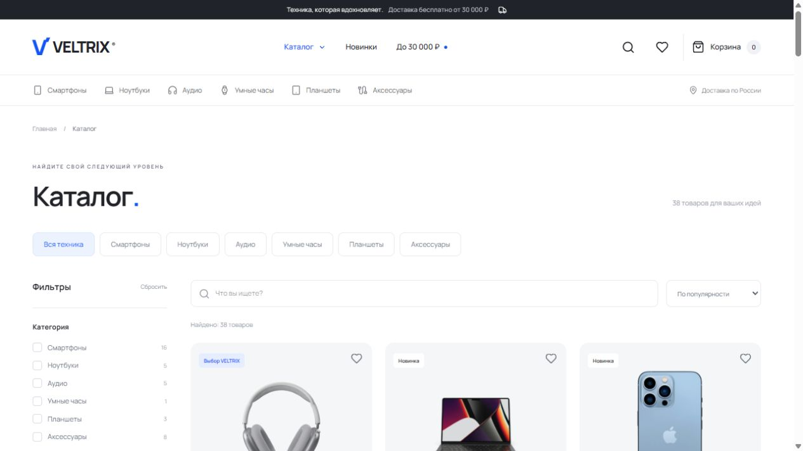

# VELTRIX

**Технологии. На вашей волне.**

[Сайт на GitHub Pages](https://dmitrysd208111.github.io/) · [Исходный код](https://github.com/Dmitrysd208111/Dmitrysd208111.github.io)

Авторский интернет-магазин электроники для Frontend-портфолио. Светлые поверхности, графитовая типографика Manrope, электрический синий и предметные фотографии. Полный пользовательский путь: поиск → выбор комплекта → корзина → демонстрационный заказ.

> Это демонстрационный продукт. Реальные продажи, оплата, письма и доставка не осуществляются. При оформлении используйте вымышленные данные.

## Возможности

- 38 товаров, 6 категорий и 96 локальных фотографий WebP.
- Главная с подборками, категориями, популярными товарами и новыми поступлениями.
- Поиск с debounce 300 мс; комбинируемые категории, бренды, диапазон цены и наличие.
- Сортировка по популярности, цене, названию и новизне. Параметры в URL, включая восстановление при навигации.
- Страница товара с галереей, характеристиками, двумя вариантами комплектации и проверкой остатка каждого SKU.
- Корзина с количеством, удалением, скидками и расчётом доставки; избранное. Сохранение через Zustand persist в localStorage.
- Оформление через React Hook Form + Zod: контакты, курьер / самовывоз, условная проверка адреса, подтверждение демо-заказа.
- Уведомления, skeleton, error / empty states, fallback изображения, Error Boundary, 404 и информационные страницы.
- Мобильная нижняя навигация, фильтры в нативном диалоге, keyboard / focus states, skip-link, aria-label и reduced motion.
- Lazy loading маршрутов, локальные variable fonts, отложенная загрузка фотографий и зарезервированное место под изображения.

## Стек

React 19 · TypeScript 5.9 strict · Vite 7 · Tailwind CSS 4 · React Router 7 · Zustand 5 · TanStack Query 5 · React Hook Form 7 · Zod 4 · Lucide React · Motion · Vitest 5 · React Testing Library.

Точные совместимые версии зафиксированы в `package-lock.json`. Система оформления построена на CSS tokens, компонентных стилях и Tailwind CSS 4 с `@theme`.

## Запуск

Нужен **Node.js 22.12+**; рекомендуется Node.js 24 LTS и npm.

```bash
npm ci
npm run dev
```

Откройте адрес, напечатанный Vite, обычно `http://127.0.0.1:5173`. Данные, фотографии и шрифты уже в проекте. API-ключи и переменные окружения не нужны, поэтому `.env.example` не требуется.

```bash
npm run typecheck    # строгая проверка TypeScript
npm run lint         # ESLint и правила React Hooks
npm test             # unit + integration, без watch
npm run test:watch   # интерактивный режим Vitest
npm run build        # TypeScript + production build → dist
npm run preview      # локальный просмотр production build
npm run format       # Prettier
npm run format:check # проверка форматирования
```

## Архитектура

```text
src/
  components/         # общие элементы, навигация, карточки, состояния
  pages/              # композиция страниц и маршруты
  features/
    home/             # hero, категории, популярные товары, подборки
    catalog/          # фильтры
    product/          # галерея, комплекты, характеристики, сервисы
    checkout/         # форма, поля, Zod-схема, подтверждение
  hooks/              # запросы, debounce, заголовки страниц
  services/           # асинхронная загрузка и runtime-валидация каталога
  store/              # корзина, избранное, toast
  types/              # единая модель Product / SKU / CartLine
  data/               # локальный каталог и происхождение изображений
  utils/              # чистые функции фильтров, цен, итогов
  test/               # unit и integration tests
public/images/        # локальные изображения товаров
```

TanStack Query управляет асинхронной загрузкой JSON-чанка; сетевого API на клиенте нет. Zod проверяет каталог во время выполнения. Zustand отвечает за клиентское состояние. Отображение товаров использует единую модель `Product`; количество хранится для пары `productId + variantId`. Перед подтверждением заказа остатки проверяются повторно.

## Правила заказа

- Все цены — целые рубли; расчёты не используют дробные денежные значения.
- Стандартный и подарочный комплекты — независимые SKU. Подарочная упаковка: +990 ₽, отдельный ограниченный остаток.
- Курьер: 490 ₽, бесплатно при сумме товаров **от 30 000 ₽ включительно**.
- Самовывоз: бесплатно при любой сумме; адрес пункта вымышленный.
- Нулевая корзина не начисляет доставку. Скидка показывается справочно и уже учтена в цене товара.
- После успешной проверки формы появляется случайный номер демо-заказа, корзина очищается. Контакты и адрес не передаются на сервер и не записываются в localStorage.
- Подтверждение живёт до ухода со страницы: история заказов и личный кабинет не входят в проект.

## Данные и фотографии

Фотографии и исходные названия взяты из [DummyJSON Products](https://dummyjson.com/docs/products); снимок каталога сделан 20 октября 2026 года. Все изображения сохранены в репозитории, runtime-зависимости от CDN нет. 96 файлов занимают около 4 МБ. Таблица источников — `src/data/image-sources.json`, исходные записи — `products-source.json`.

Цены в рублях, рейтинги, количества оценок, комплектации и остатки придуманы для демонстрации. «Новинка» означает новое поступление в демонстрационную коллекцию, а не год выпуска. Названия моделей соответствуют изображениям источника. Точные коммерческие характеристики не заявляются.

Повторный импорт доступен через `node scripts/prepare-catalog.mjs` из корня проекта; нужен интернет, команда перезапишет сгенерированный каталог и изображения. Происхождение и условия использования сторонних материалов описаны в [THIRD_PARTY_NOTICES.md](THIRD_PARTY_NOTICES.md).

## Проверки

Тесты проверяют ограничения остатков и варианты комплекта, persistence корзины / избранного, комбинации и восстановление URL-фильтров, debounce, сортировку, пограничные стоимости доставки, валидацию контактов и адреса, keyboard-активацию карточки, прямые маршруты, 404 и путь от каталога до заказа. Отдельно проверяются runtime-схема каталога и наличие каждого локального изображения.

Фактические результаты и оставшиеся ручные проверки — [docs/QA.md](docs/QA.md). В GitHub Actions настроены typecheck, lint, test, build и публикация GitHub Pages. Проверки успешно выполнены и локально, и в GitHub Actions; результаты доступны на вкладке Actions репозитория.

## Скриншоты

Настоящие скриншоты опубликованного сайта, сделанные 22 октября 2026 года.





Снимки подтверждают отображение главной, каталога и карточки товара на мобильном экране. Полный список оставшихся проверок доступности и разных разрешений — в [docs/QA.md](docs/QA.md).

## GitHub и Vercel

Основная публикация настроена на **GitHub Pages**: `https://dmitrysd208111.github.io/`. После каждого push в `main` workflow проверяет типы, линтер и тесты, собирает приложение и публикует `dist`. Для известных маршрутов генерируются отдельные HTML-точки входа, поэтому каталог, карточки товаров и корзина открываются напрямую и после обновления страницы. Неизвестные адреса используют собственную страницу 404. Настройка основана на [документации Vite](https://vite.dev/guide/static-deploy.html#github-pages).

Альтернативное размещение на Vercel:

1. Создайте пустой GitHub-репозиторий и загрузите содержимое этой папки вместе с `package-lock.json` и `public/images/`. Не загружайте `node_modules` и `dist`.
2. В Vercel выберите **Add New → Project → Import Git Repository**.
3. Framework Preset: **Vite**; Root Directory: корень репозитория; Install Command: `npm ci`; Build Command: `npm run build`; Output Directory: `dist`; Node.js: **24.x**.
4. Переменные окружения не нужны. Нажмите **Deploy**.
5. Проверьте прямое открытие и обновление `/catalog`, `/product/apple-airpods-max-silver`, `/cart` и `/checkout`.

`vercel.json` содержит SPA rewrite на `index.html`, сохраняя запросы к `/assets/`, `/images/` и favicon. React Router обрабатывает вложенные маршруты и показывает собственную страницу 404. Для другого статического хостинга понадобится аналогичный fallback на `index.html`. Основание настройки: [официальная документация Vite на Vercel](https://vercel.com/docs/frameworks/frontend/vite).

Репозиторий предназначен для сайта пользователя GitHub Pages с корневым `base: '/'`. Для размещения внутри пути другого репозитория потребуется отдельно изменить базовый путь ресурсов и маршрутизатора.

## Лицензия

[MIT](LICENSE) — код проекта. Права на фотографии, шрифт, значки и товарные знаки описаны отдельно в [THIRD_PARTY_NOTICES.md](THIRD_PARTY_NOTICES.md).
